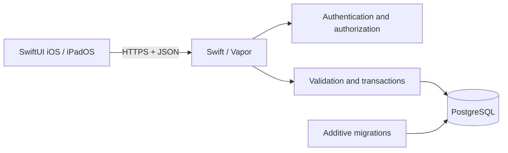

# Gymnastics Club

[](https://github.com/Rhaemira/GymnasticsClub/actions/workflows/ios.yml)
[](https://github.com/Rhaemira/GymnasticsClub/actions/workflows/backend.yml)
[](https://swift.org)
[](https://developer.apple.com/ios/)

A full-stack gymnastics club management platform. The native SwiftUI application provides the administrator experience; a Swift/Vapor API enforces authentication, authorization and business rules; PostgreSQL is the system of record.

## Product capabilities

- Administrator authentication with expiring and revocable bearer sessions.
- Athlete and coach management.
- Class scheduling, enrollment and capacity enforcement.
- Attendance tracking and duplicate protection.
- Dashboard metrics, reports and analytics.
- Native iOS navigation, Keychain-backed credentials and undoable management actions.

## Repository layout

```text
GymnasticsClub/
├── ios/                    # SwiftUI iPhone and iPad application
│   ├── GymnasticsClubApp.xcodeproj
│   └── GymnasticsClubAppTests/
├── backend/                # Swift / Vapor REST API
│   ├── Sources/
│   ├── Tests/
│   ├── Scripts/
│   └── docker-compose.yml
├── docs/
│   ├── API_CONTRACT.md     # Shared client/server contract
│   ├── ARCHITECTURE.md
│   ├── RELEASE_CHECKLIST.md
│   └── SUBTREE_WORKFLOW.md
└── .github/workflows/      # Independent iOS and backend CI pipelines
```

The standalone repositories are the component upstreams:

- [GymnasticsClubApp](https://github.com/Rhaemira/GymnasticsClubApp) — iOS client.
- [GymnasticsClubBackend](https://github.com/Rhaemira/GymnasticsClubBackend) — API and database.

The `ios/` and `backend/` directories are Git subtrees. Make component changes in their standalone repositories and synchronize reviewed changes here using [docs/SUBTREE_WORKFLOW.md](docs/SUBTREE_WORKFLOW.md). Avoid hand-copying or independently editing subtree contents.

## Architecture



The backend is authoritative for validation, authorization, enrollment capacity, attendance uniqueness and persistence. The iOS client never acts as the security boundary. See [docs/ARCHITECTURE.md](docs/ARCHITECTURE.md) and [docs/API_CONTRACT.md](docs/API_CONTRACT.md).

## Requirements

- Xcode 26.5 or newer and the iOS 26.5 SDK.
- Swift 6 toolchain for the backend.
- PostgreSQL 14+ for native backend development, or Docker Desktop with Compose v2.
- macOS for building and running the iOS application.

## Quick start

### 1. Start the backend

```bash
cd backend
cp .env.example .env
```

Edit `.env` and set a unique local database password. Then:

**Docker Compose**

```bash
docker compose up --build -d
curl --fail http://127.0.0.1:8080/health
```

**Native macOS**

```bash
Scripts/setup.sh
# Create the PostgreSQL role and database named in .env, then:
Scripts/migrate.sh
Scripts/start.sh
```

Create the first administrator in another terminal:

```bash
cd backend
Scripts/create-admin.sh
```

The password is prompted without echo. Do not put real credentials in source control or command history. See [backend/README.md](backend/README.md) for detailed setup and operations.

### 2. Run the iOS app

Open `ios/GymnasticsClubApp.xcodeproj` in Xcode and select the shared `GymnasticsClubApp` scheme.

For Simulator development, the Debug configuration uses `http://127.0.0.1:8080`. For a physical device, set `API_BASE_URL` to a reachable Mac LAN address or development HTTPS endpoint. Release builds require HTTPS.

### 3. Build and test

From the repository root:

**iOS**

```bash
cd ios
xcodebuild -project GymnasticsClubApp.xcodeproj \
  -scheme GymnasticsClubApp \
  -sdk iphonesimulator \
  -destination 'generic/platform=iOS Simulator' \
  CODE_SIGNING_ALLOWED=NO \
  API_BASE_URL=https://api.example.invalid build

xcodebuild test -project GymnasticsClubApp.xcodeproj \
  -scheme GymnasticsClubApp \
  -destination 'platform=iOS Simulator,name=iPhone 17 Pro' \
  CODE_SIGNING_ALLOWED=NO \
  API_BASE_URL=https://api.example.invalid \
  -parallel-testing-enabled NO
```

**Backend** (requires a dedicated disposable PostgreSQL database and the variables documented in `backend/.env.example`):

```bash
cd backend
swift package resolve
swift build
swift test
```

Never run integration tests against production data.

## CI

- **iOS CI** builds Debug and Release Simulator configurations, runs Xcode static analysis and executes XCTest.
- **Backend CI** runs Linux/PostgreSQL integration tests, native macOS startup/migration smoke tests and Docker Compose deployment checks.

A green workflow validates the automated checks for that commit. Physical-device testing, production configuration, backups and restore drills remain release responsibilities.

## Security and data safety

- Production API traffic must use HTTPS.
- Passwords are hashed by the backend; only token digests are stored server-side.
- The iOS app stores its bearer token in the device Keychain.
- Use a dedicated least-privilege PostgreSQL role and keep secrets outside source control.
- Never run the historical destructive cascade-fix migration; it is intentionally not registered.
- Back up PostgreSQL and test restores into an isolated database.
- Do not trust proxy forwarding headers unless the immediate proxy is explicitly trusted.

See [SECURITY.md](SECURITY.md), [backend/SECURITY.md](backend/SECURITY.md) and [backend/docs/OPERATIONS.md](backend/docs/OPERATIONS.md).

## Contributing

See [CONTRIBUTING.md](CONTRIBUTING.md). Security issues should be reported privately according to [SECURITY.md](SECURITY.md).

## Release readiness

Use [docs/RELEASE_CHECKLIST.md](docs/RELEASE_CHECKLIST.md) before distributing a release. Do not merge or deploy while required checks are failing or still running.
