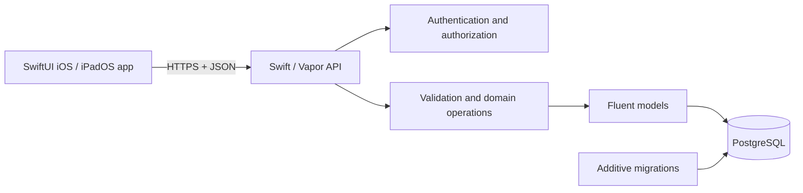

# Gymnastics Club architecture

## System overview

## Component ownership

| Component | Responsibility | Upstream |
|---|---|---|
| iOS client | Authentication UI, navigation, club workflows, local presentation state | [GymnasticsClubApp](https://github.com/Rhaemira/GymnasticsClubApp) |
| Backend | API, authorization, validation, transactions, migrations and operations | [GymnasticsClubBackend](https://github.com/Rhaemira/GymnasticsClubBackend) |
| Shared contract | Request/response shapes, date formats, error semantics and compatibility | `docs/API_CONTRACT.md` |

PostgreSQL is the system of record. The iOS app is a client, not an authorization boundary. The backend is authoritative for validation, enrollment capacity, attendance uniqueness and persistence.

## Authentication lifecycle

1. The administrator signs in through the public login endpoint.
2. The backend verifies the password and issues a random, expiring bearer token.
3. The iOS app stores the token in the device Keychain.
4. Authenticated requests send the token in the Authorization header.
5. The backend validates token digest, expiry and revocation state.
6. Sign-out attempts server-side revocation and always clears the local credential.

The client preserves a saved credential during temporary network failures and invalidates it only when the server rejects it as unauthenticated.

## Data integrity

Database constraints and transactions protect invariants that cannot safely depend on client behavior. Migrations must be additive and preserve populated tables. The historical destructive cascade-fix migration is intentionally not registered.

## Monorepo synchronization

The standalone repositories are the component upstreams. Synchronize changes into `ios/` and `backend/` with Git subtree operations; see [SUBTREE_WORKFLOW.md](SUBTREE_WORKFLOW.md). The API contract in this repository must be updated in the same change as any wire-format change.
